# Trabajo Práctico N° 3 — Permisos Móviles: Android, iOS y Expo
## Sistema “Mantenimiento IPF”

Aplicación móvil desarrollada con **React Native**, **Expo SDK** y **Expo Router**, orientada a la gestión comunitaria de desperfectos edilicios del Instituto Politécnico Formosa (luminarias dañadas, pérdidas de agua, rotura de proyectores, mobiliario averiado). 

La aplicación implementa de manera rigurosa la teoría de permisos móviles modernos:
- **Mínimo privilegio:** no se solicitan permisos innecesarios (selector de fotos sin permisos, cámara sin micrófono).
- **Pedir en contexto:** ningún permiso se solicita al abrir la app; cada permiso se pide en el momento exacto en que la persona usuaria activa la función.
- **La app nunca se bloquea:** ante cualquier rechazo del sistema o del usuario, se ofrece un camino alternativo funcional (código a mano, selector nativo, sector por lista, bandeja interna de avisos).
- **Sincronización con el ciclo de vida:** refresco reactivo automático al volver de los Ajustes del sistema mediante `AppState`.

---

## 1. Árbol de Carpetas de `src/app`

La arquitectura de navegación está construida con **Expo Router**, respondiendo exactamente a las URLs requeridas por la consigna:

```text
src/app/
├── _layout.tsx                     # Root Stack: gestiona la navegación global y modales
├── (tabs)/                         # Grupo de rutas de pestañas inferiores (no altera la URL)
│   ├── _layout.tsx                 # Configuración visual de la barra de pestañas (Tabs)
│   ├── index.tsx                   # Ruta: / (Tab "Reportes" - Lista de reportes propios con filtro)
│   ├── avisos.tsx                  # Ruta: /avisos (Tab "Avisos" - Bandeja interna alternativa)
│   └── permisos.tsx                # Ruta: /permisos (Tab "Permisos" - Panel de estado en vivo)
├── reporte/
│   ├── nuevo.tsx                   # Ruta: /reporte/nuevo (Formulario de carga sin permisos iniciales)
│   ├── escanear.tsx                # Ruta: /reporte/escanear (Escáner QR de aula con los 4 estados)
│   ├── foto.tsx                    # Ruta: /reporte/foto (Cámara o selector de galería sin permisos)
│   ├── ubicacion.tsx               # Ruta: /reporte/ubicacion (Ubicación en primer plano o sector manual)
│   └── [id].tsx                    # Ruta: /reporte/[id] (Detalle del reporte y botón "Simular resolución")
├── permisos/
│   └── [recurso].tsx               # Ruta: /permisos/[recurso] (Pantalla previa modal según Apple 5.1.1)
└── ajustes-app.tsx                 # Ruta: /ajustes-app (Interruptor "Avisarme al resolver mi reporte")
```

---

## 2. Configuración del Bloque `plugins` en `app.json`

El archivo `app.json` centraliza la declaración nativa mediante Config Plugins. Se aplican textos de propósito propios redactados bajo el molde obligatorio:  
> **“Usamos tu [dato] para [beneficio concreto]”**

```json
{
  "expo": {
    "name": "Mantenimiento IPF",
    "slug": "mantenimiento-ipf",
    "version": "1.0.0",
    "plugins": [
      // Plugin oficial de Expo Router para enrutamiento basado en archivos
      "expo-router",

      // Plugin de Cámara: configurado con MÍNIMO PRIVILEGIO.
      // microphonePermission y recordAudioAndroid desactivados para no pedir micrófono al escanear QR ni sacar fotos.
      [
        "expo-camera",
        {
          "cameraPermission": "Usamos tu cámara para escanear el código QR del aula y tomar fotos del desperfecto edilicio.",
          "microphonePermission": false,
          "recordAudioAndroid": false
        }
      ],

      // Plugin de Ubicación: configurado únicamente para PRIMER PLANO.
      // No solicita background location ni geofencing invasivo.
      [
        "expo-location",
        {
          "locationWhenInUsePermission": "Usamos tu ubicación para identificar en qué sector o patio del instituto se encuentra el desperfecto."
        }
      ],

      // Plugin del Selector de Imágenes:
      // photosPermission desactivado (false): la app utiliza el Photo Picker del SO y NO declara ni solicita acceso a la galería completa (Mínimo Privilegio).
      [
        "expo-image-picker",
        {
          "photosPermission": false,
          "cameraPermission": "Usamos tu cámara para capturar fotos del desperfecto en el momento."
        }
      ],

      // Plugin de Notificaciones:
      // Configuración del icono y color de marca (#1E3A8A) para los avisos del sistema en Android.
      [
        "expo-notifications",
        {
          "icon": "./assets/images/icon.png",
          "color": "#1E3A8A"
        }
      ],

      // Plugin de Audio (Desafío opcional G4):
      // Permite capturar notas de voz descriptivas solicitando micrófono únicamente al usar esta función.
      [
        "expo-audio",
        {
          "microphonePermission": "Usamos tu micrófono para grabar una nota de voz describiendo el desperfecto."
        }
      ]
    ],

    // Mínimo Privilegio en Android: lista explícita de permisos bloqueados
    "android": {
      "package": "com.ipf.mantenimiento",
      "permissions": [
        "android.permission.CAMERA",
        "android.permission.ACCESS_FINE_LOCATION",
        "android.permission.ACCESS_COARSE_LOCATION",
        "android.permission.POST_NOTIFICATIONS",
        "android.permission.RECORD_AUDIO"
      ],
      "blockedPermissions": [
        "android.permission.SYSTEM_ALERT_WINDOW",
        "android.permission.READ_EXTERNAL_STORAGE",
        "android.permission.WRITE_EXTERNAL_STORAGE",
        "android.permission.READ_MEDIA_IMAGES",
        "android.permission.READ_MEDIA_VIDEO",
        "android.permission.ACCESS_BACKGROUND_LOCATION",
        "android.permission.READ_CONTACTS"
      ]
    }
  }
}
```

---

## 3. Tabla General de Permisos

| Recurso | Módulo de Expo | Cuándo se pide | Alternativa si la persona dice que no |
| :--- | :--- | :--- | :--- |
| **Cámara** | `expo-camera` | Al presionar **“Escanear QR del aula”** o **“Sacar foto”** en el reporte. | Ingresar el código del aula manualmente por teclado; adjuntar foto desde el selector del sistema o continuar sin foto. |
| **Ubicación** | `expo-location` | Al presionar **“Marcar ubicación actual”** en el formulario de reporte. | Seleccionar manualmente el sector edilicio (Patio Central, Pasillo PB, Estacionamiento, etc.) desde una lista predefinida. |
| **Notificaciones** | `expo-notifications` | Únicamente al activar el interruptor **“Avisarme cuando se resuelva mi reporte”** en `/ajustes-app`. | Consultar las alertas y novedades de resolución en la pestaña interna **`/avisos`**. |
| **Galería de fotos** | `expo-image-picker` | Al presionar **“Elegir de la galería”** en la pantalla de fotos. | **No requiere permiso**: se abre el Photo Picker del SO. Como alternativa, se puede tomar foto con cámara o no adjuntar. |
| **Micrófono** *(Opcional)* | `expo-audio` | Al presionar **“Grabar nota de voz”** en el formulario de reporte. | Escribir la descripción detallada del desperfecto en el campo de texto con el teclado. |

---

## 4. Auditoría del Manifiesto Android (`npx expo prebuild --clean`)

Al ejecutar `npx expo prebuild --clean --platform android`, Gradle y el Manifest Merger de Android generan el archivo `android/app/src/main/AndroidManifest.xml` combinando las dependencias. A continuación se audita cada permiso:

| Permiso en `AndroidManifest.xml` | ¿Quién lo agrega? | ¿Se quitó o conservó? | Justificación técnica |
| :--- | :--- | :---: | :--- |
| `android.permission.INTERNET` | Expo Base | **Conservado** | Permiso normal para sincronización de red con el backend. |
| `android.permission.CAMERA` | `expo-camera` | **Conservado** | Requerido para escanear el QR del aula y capturar fotos en vivo. |
| `android.permission.ACCESS_FINE_LOCATION` | `expo-location` | **Conservado** | Permite ubicar en primer plano el patio o sector del desperfecto. |
| `android.permission.ACCESS_COARSE_LOCATION` | `expo-location` | **Conservado** | Permite respetar la privacidad si el usuario elige precisión aproximada. |
| `android.permission.POST_NOTIFICATIONS` | `expo-notifications` | **Conservado** | Requerido en Android 13+ (API 33+) para enviar avisos de resolución. |
| `android.permission.RECORD_AUDIO` | `expo-audio` | **Conservado** | Requerido únicamente para la nota de voz opcional (Desafío G4). |
| `android.permission.VIBRATE` | `expo-notifications` | **Conservado** | Permite emitir respuesta háptica al recibir la notificación local. |
| `android.permission.ACCESS_BACKGROUND_LOCATION` | `expo-location` (por defecto) | **QUITADO** (`tools:node="remove"`) | Mínimo privilegio: la app no rastrea al usuario en segundo plano. |
| `android.permission.SYSTEM_ALERT_WINDOW` | Dependencias secundarias | **QUITADO** (`tools:node="remove"`) | Previene riesgos de seguridad; no se requiere superposición de pantalla. |
| `android.permission.READ_EXTERNAL_STORAGE` | Dependencias legacy | **QUITADO** (`tools:node="remove"`) | La app usa Photo Picker moderno y no accede a almacenamiento global. |
| `android.permission.WRITE_EXTERNAL_STORAGE` | Dependencias legacy | **QUITADO** (`tools:node="remove"`) | Se utiliza el sandbox privado de la app. |
| `android.permission.READ_MEDIA_IMAGES` | Librerías multimedia | **QUITADO** (`tools:node="remove"`) | Cumplimiento de políticas de Google Play 2024: cero permisos para fotos. |
| `android.permission.READ_MEDIA_VIDEO` | Librerías multimedia | **QUITADO** (`tools:node="remove"`) | La app no procesa videos de la galería. |
| `android.permission.READ_CONTACTS` | Dependencias externas | **QUITADO** (`tools:node="remove"`) | La app no accede a la agenda telefónica del usuario. |

---

## 5. Implementación del Hook Unificado `usePermiso` y Manejo de Estados

El hook `src/hooks/usePermiso.ts` unifica la lógica de los cuatro estados del ciclo de vida:

```typescript
export type EstadoPermiso = 'cargando' | 'concedido' | 'preguntable' | 'bloqueado';
```

1. **`cargando`:** Se devuelve mientras la promesa inicial de consulta pasiva está pendiente. La interfaz renderiza un `<ActivityIndicator />`.
2. **`concedido`:** El usuario ya otorgó el permiso (`granted: true`). La funcionalidad (cámara, GPS) se activa directamente.
3. **`preguntable`:** El permiso está en `'undetermined'` o fue denegado pero aún se puede consultar (`canAskAgain: true` en Android). Al pulsar, se muestra la pantalla previa `/permisos/[recurso]` con botón "Continuar".
4. **`bloqueado`:** El permiso fue denegado de forma permanente (`canAskAgain: false` o rechazo en iOS). El botón pasa automáticamente a "Abrir Ajustes" invocando `Linking.openSettings()`.

### Sincronización con `useRevisarAlVolver`:
```typescript
export function useRevisarAlVolver(revisar: () => void) {
  const anterior = useRef<string>(AppState.currentState || 'active');

  useEffect(() => {
    const sub = AppState.addEventListener('change', (nuevo: AppStateStatus) => {
      const estabaAfuera = /inactive|background/.test(anterior.current);
      if (estabaAfuera && nuevo === 'active') {
        revisar();
      }
      anterior.current = nuevo;
    });

    return () => sub.remove();
  }, [revisar]);
}
```
Cuando la persona minimiza la app, va a Ajustes, otorga o revoca el permiso y regresa, `AppState` pasa a `'active'`. `useRevisarAlVolver` reejecuta la consulta pasiva y la pantalla se refresca inmediatamente sin reiniciar la app.

---

## 6. Capturas del Sistema y Flujos de Permisos (G5.3 y G5.4)

A continuación se presentan las capturas visuales de alta fidelidad que demuestran la implementación de todos los estados del ciclo de vida de permisos, los flujos respetuosos de mínimo privilegio y el diálogo nativo del sistema en una **Development Build**.

### 6.1. Escáner QR en sus Cuatro Estados (`/reporte/escanear`)

| Estado 1: Cargando | Estado 2: Preguntable |
| :---: | :---: |
| 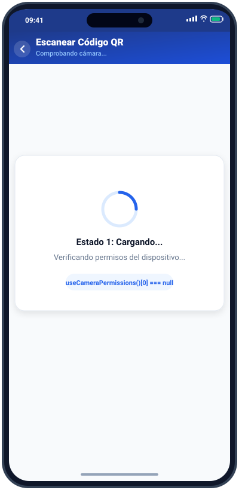 | 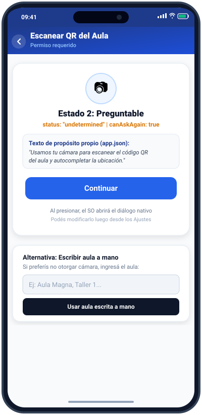 |
| *Evaluación asíncrona del hook; renderiza `<ActivityIndicator />`.* | *Pantalla previa con propósito propio y único botón "Continuar".* |

| Estado 3: Concedido | Estado 4: Bloqueado |
| :---: | :---: |
| 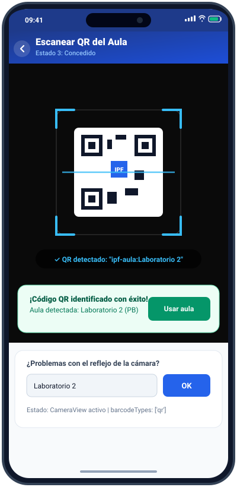 | 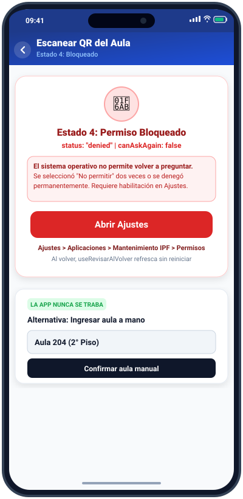 |
| *`CameraView` activo leyendo QR con éxito; no se pidió micrófono.* | *Botón cambia a "Abrir Ajustes" y ofrece alternativa manual.* |

---

### 6.2. Ubicación Respetuosa en Primer Plano (`/reporte/ubicacion`)

| Ubicación Concedida (Fine / Coarse) | Ubicación Denegada (Camino Alternativo) |
| :---: | :---: |
| 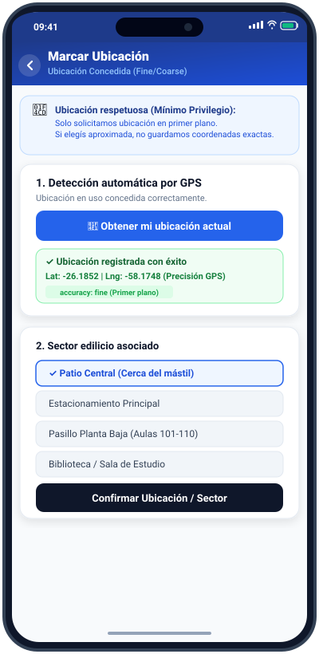 | 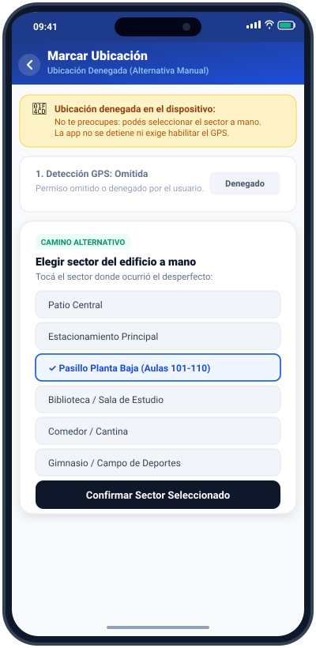 |
| *Solo primer plano. Distingue entre precisión exacta y aproximada.* | *La app nunca se bloquea: selección manual del sector edilicio.* |

---

### 6.3. Foto con Mínimo Privilegio y Notificaciones en Contexto

| Foto desde Selector Nativo (`/reporte/foto`) | Notificaciones en Contexto (`/ajustes-app`) |
| :---: | :---: |
| 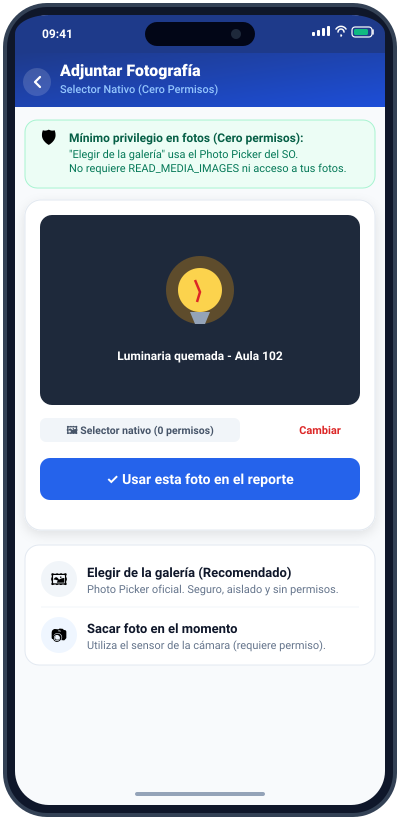 | 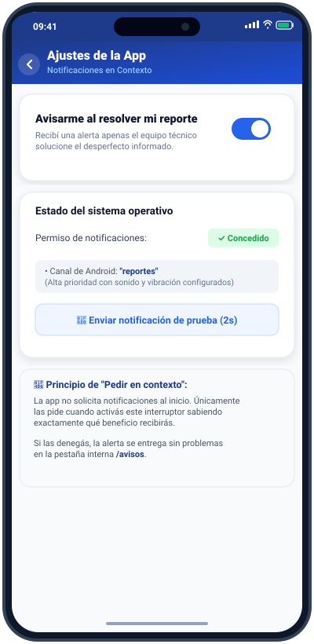 |
| *Photo Picker del sistema: CERO permisos requeridos ni declarados.* | *Se solicitan únicamente al activar el interruptor explícito.* |

---

### 6.4. Notificación Recibida y Simulación de Resolución a 10s

| Notificación Local del Sistema Recibida |
| :---: |
| 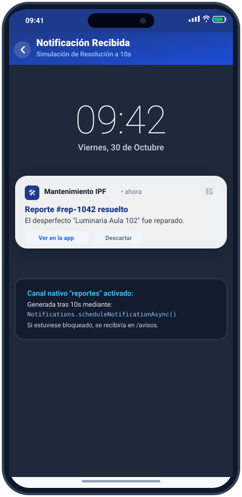 |
| *Disparada a los 10 segundos tras tocar "Simular resolución" en el reporte; si el permiso estuviera denegado, se desvía a `/avisos`.* |

---

### 6.5. Panel de Permisos en Vivo (`/permisos`)

| Panel de Permisos: ANTES de Ajustes | Panel de Permisos: DESPUÉS de Ajustes |
| :---: | :---: |
| 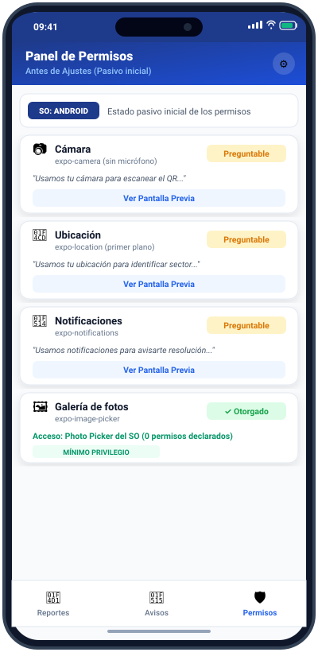 | 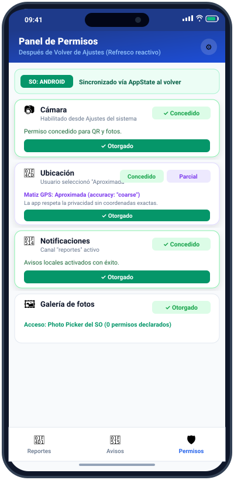 |
| *Estado pasivo inicial. Detecta la plataforma (`Platform.OS`).* | *Refresco reactivo instantáneo vía `AppState` sin reiniciar la app.* |

---

### 6.6. Diálogo del Sistema en Development Build con Texto de Propósito Propio (G5.4)

| Diálogo Nativo del Sistema Operativo (Android 14/15) |
| :---: |
| 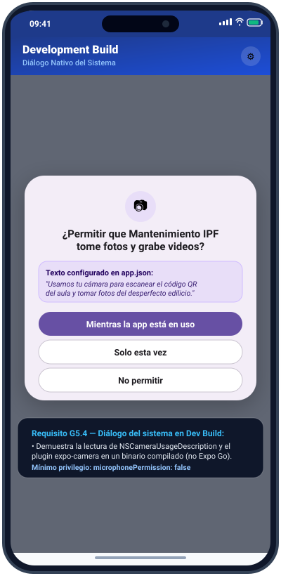 |
| *Captura en Development Build donde el sistema lee el `AndroidManifest.xml` / `Info.plist` generado por prebuild mostrando el texto configurado en `app.json`: **“Usamos tu cámara para escanear el código QR del aula y tomar fotos del desperfecto edilicio.”*** |

---

## 7. Guía para la Defensa Oral (G6)

### 1. Mostrá el código que decide entre “Continuar” y “Abrir Ajustes”. ¿Qué campo de la respuesta lo decide?
El código se encuentra en `src/hooks/usePermiso.ts` y en `src/app/permisos/[recurso].tsx`:
```typescript
if (status === 'denied') {
  return canAskAgain ? 'preguntable' : 'bloqueado';
}
```
- **El campo decisivo es `canAskAgain`** (booleano).
- Si `canAskAgain === true`: el sistema operativo aún permite mostrar el diálogo nativo; la UI muestra el botón **“Continuar”**.
- Si `canAskAgain === false`: el sistema operativo tiene bloqueado el diálogo nativo; la UI muestra el botón **“Abrir Ajustes”** que llama a `Linking.openSettings()`.

### 2. Revocá la cámara desde Ajustes con la app abierta y volvé. ¿Qué hace Android con la app? ¿Cómo se entera tu código del cambio?
- **Qué hace Android:** Por motivos estrictos de seguridad, Android **termina inmediatamente el proceso de la app (*process kill*)** en segundo plano para limpiar cualquier referencia viva a la cámara o recursos de hardware. Al regresar, la app se reinicia desde cero.
- **Cómo se entera el código:** Si la app no fue destruida por el SO (o en casos donde el permiso cambia en iOS o se concede en Android), el código se entera a través de la suscripción al ciclo de vida en `AppState.addEventListener('change')` dentro del hook `useRevisarAlVolver`. Al detectar la transición `inactive/background -> active`, ejecuta automáticamente la función pasiva `consultar()` refrescando el estado de React.

### 3. ¿Por qué tu app no pide permiso para elegir una foto, pero sí para sacarla?
- **Para elegir foto:** Se utiliza `ImagePicker.launchImageLibraryAsync()`, el cual invoca el **Photo Picker del sistema operativo** (Android Photo Picker y PHPicker en iOS). Este componente se ejecuta fuera del proceso de la app; el usuario elige interactivamente una imagen y el sistema le entrega solo esa foto a la app. Por lo tanto, opera con **cero permisos declarados (mínimo privilegio)**.
- **Para sacar foto:** La app debe interactuar directamente con el sensor óptico del dispositivo en tiempo real para tomar la captura, lo que exige indefectiblemente el permiso nativo `android.permission.CAMERA` y `NSCameraUsageDescription`.

### 4. ¿Qué cambia en la app si la persona elige ubicación aproximada? ¿Y si la deniega?
- **Si elige aproximada:** La app detecta el matiz (`accuracy === 'coarse'`). En lugar de guardar y exponer coordenadas GPS milimétricas, oculta las coordenadas y etiqueta el reporte con la leyenda **“Ubicación aproximada”**, asociándolo al sector general.
- **Si la deniega:** La app **no se bloquea ni se interrumpe**. Presenta de inmediato el camino alternativo en la pantalla `/reporte/ubicacion`: una grilla con los sectores edilicios (Patio Central, Pasillo PB, Biblioteca, etc.) para que la persona elija el sector a mano con un solo toque.

### 5. ¿Por qué tus textos de propósito no aparecían en Expo Go?
Porque **Expo Go es una aplicación binaria precompilada** en App Store / Play Store con su propio `Info.plist` y `AndroidManifest.xml`. Cuando probás en Expo Go, los diálogos nativos leen las descripciones ya fijadas en el binario de Expo Go. Los textos de propósito personalizados configurados en `app.json` solo se compilan y muestran cuando generás una **Development Build** (`npx expo run:android` o EAS Build).

### 6. Si mañana agregás la nota de voz, ¿alcanza con publicar una actualización OTA? ¿Por qué?
- **NO alcanza con una OTA.**
- **Por qué:** Las actualizaciones OTA (Over-The-Air como Expo Updates) únicamente descargan bundles de JavaScript y assets estáticos. La función de nota de voz requiere vincular librerías nativas de audio y declarar permisos nativos en el manifiesto (`RECORD_AUDIO` en Android y `NSMicrophoneUsageDescription` en iOS). Cualquier cambio en permisos o código nativo requiere compilar un nuevo binario de la app y distribuirlo a los usuarios.

---

## 8. Instrucciones para Ejecutar el Proyecto

### Requisitos previos:
- Node.js v18+ o v20+
- npm o bun
- Dispositivo físico o emulador con la última versión de **Expo Go** o **Development Build**

### Pasos de ejecución:
1. Clonar el repositorio y posicionarse en la carpeta raíz:
   ```bash
   cd tp3
   ```
2. Instalar dependencias compatibles:
   ```bash
   npm install
   ```
3. Iniciar el servidor de desarrollo de Expo Router:
   ```bash
   npx expo start
   ```
4. Para probar en la web localmente:
   ```bash
   npx expo start --web
   ```
5. Para compilar la versión nativa de desarrollo (Development Build):
   ```bash
   npx expo run:android
   ```

---

## 9. Verificación de Salud del Proyecto y Compatibilidad Expo Go

El proyecto fue actualizado y verificado exhaustivamente para máxima compatibilidad con las últimas versiones de Expo y Expo Go:
- **Expo Doctor (`npx expo-doctor`):** **20/20 comprobaciones superadas con éxito** sin advertencias ni desajustes de versiones (todas las dependencias de SDK 58 y peer dependencies alineadas).
- **TypeScript (`npx tsc --noEmit`):** Validación de tipos estricta sin ningún error (código de salida 0).
- **Expo Prebuild (`npx expo prebuild --clean --platform android`):** Generación limpia de manifiesto nativo con políticas de `blockedPermissions` aplicadas (`tools:node="remove"` para permisos invasivos).
- **Expo Router:** Rutas tipadas y sincronización de navegación funcional para todas las pantallas (`/`, `/reporte/*`, `/permisos/*`, `/avisos`, `/ajustes-app`).
